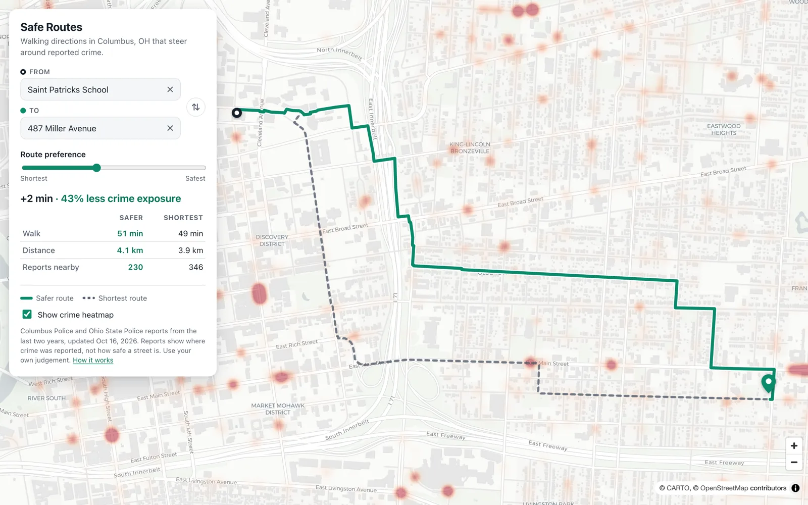

# Safe Routes

Walking directions in Columbus, OH that steer around streets with recent reported crime.

**[Live demo →](https://rathem30.github.io/safe-routes/)**



Pick a start and destination by searching or clicking the map. The app draws the safer route next to the shortest one and tells you the trade-off, for example *"+1 min · 35% less crime exposure"*. Drag the slider from *Shortest* to *Safest* and the route updates instantly.

## How it works

The full explanation, with formulas, worked examples and tuning data, is in **[How risk is calculated](docs/how-risk-works.md)**. In short:

1. **Live crime data.** A GitHub Action runs every morning. It pulls the last two years of incidents from the [City of Columbus police open data service](https://opendata.columbus.gov/) and the [Ohio State University Police daily crime log](https://dps.osu.edu/daily-crime-log), then redeploys the site. Each report becomes `[latitude, longitude, weight]`. The weight combines severity (homicide counts far more than shoplifting) and recency (it halves for each year of age). Non-crimes such as lost property and traffic accidents are left out.
2. **Street network.** Every walkable street in central Columbus (about 200,000 nodes) is extracted from OpenStreetMap ahead of time and shipped as a 700 KB gzipped file. The app needs no routing server.
3. **Risk per street.** In the browser, each street segment is sampled every 25 m. Every report within 100 m adds its weight, fading linearly with distance. A spatial grid keeps this to a few hundred milliseconds for the whole city.
4. **Routing.** A\* runs with edge cost

   ```
   cost = length × (1 + λ · ln(1 + risk))
   ```

   λ comes from the slider and runs from 0 to 3. With λ = 0 the result is the plain shortest route. The log stops one address with dozens of reports from making a whole block impassable. Because cost is never below length, straight-line distance stays an admissible heuristic, so every route is optimal for its setting.
5. **Comparison.** The shortest route is computed separately and both are scored with the same exposure measure, so the percentage shown is an apples-to-apples comparison.

Routing runs in a Web Worker. Each route takes about 10–20 ms.

## Run it locally

```sh
npm install
npm run dev      # http://localhost:5173
npm test         # unit tests for the router, spatial index, heap and data pipeline
npm run lint
```

## Data pipeline

The data files are committed and refreshed daily by CI, so none of this is needed to run the app.

```sh
# Fetch the latest Columbus Police and Ohio State Police incidents
npm run update:crimes

# Street network, from an OpenStreetMap extract
pip install osmium
curl -LO https://download.geofabrik.de/north-america/us/ohio-latest.osm.pbf
python scripts/build-streets.py ohio-latest.osm.pbf public/streets.json
```

- **Columbus Police** incidents come with block-level coordinates. They are scored by subject using `scripts/data/cpd_subject_severity.tsv`.
- **Ohio State Police** only publishes the last 60 days and names places rather than giving coordinates. Every incident is archived in `data/osu-incidents.json` so history builds past that window. Place names are geocoded once with Nominatim and cached in `scripts/data/osu_locations.tsv`; fix or fill in entries there by hand if a lookup is wrong. Unfounded reports and reports taken at emergency departments are skipped.
- Severity scores (lower is more severe) live in `scripts/data/`. If a source is down, the previous data stays live.

## Limitations

- **Reported crime is not the same as danger.** Reports cluster where police patrol and where people report incidents, such as stores and hospitals. Routing around them can mean routing around lower-income neighborhoods. Treat the result as one input, not a safety guarantee.
- Police data lags a few days behind real time.
- Coverage is central Columbus, roughly Clintonville to the South Side and Franklinton to Bexley.

## Built with

React, Vite, MapLibre GL, OpenStreetMap data (© OpenStreetMap contributors, ODbL), CARTO basemaps, Nominatim geocoding and Columbus Police public reports.
