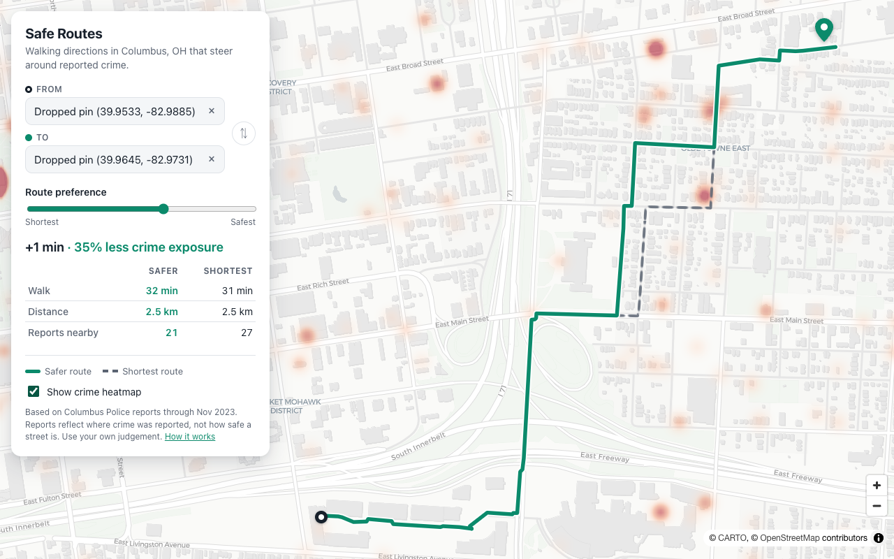

# Safe Routes

Walking directions in Columbus, OH that steer around streets with recent reported crime.

**[Live demo →](https://rathem30.github.io/safe-routes/)**



Pick a start and destination by searching or clicking the map. The app draws the safer route next to the shortest one and tells you the trade-off, for example *"+1 min · 35% less crime exposure"*. Drag the slider from *Shortest* to *Safest* and the route updates instantly.

## How it works

1. **Crime data.** About 12,000 Columbus Police reports are reduced offline to `[latitude, longitude, weight]`. The weight combines severity (homicide counts far more than shoplifting) and recency (it halves for each year of age). No names, addresses or narratives are published.
2. **Street network.** Every walkable street in central Columbus (about 200,000 nodes) is extracted from OpenStreetMap ahead of time and shipped as a 700 KB gzipped file. The app needs no routing server.
3. **Risk per street.** In the browser, each street segment is sampled every 25 m. Every report within 100 m adds its weight, fading linearly with distance. A spatial grid keeps this to a few hundred milliseconds for the whole city.
4. **Routing.** A\* runs with edge cost

   ```
   cost = length × (1 + λ · ln(1 + risk))
   ```

   λ comes from the slider. With λ = 0 the result is the plain shortest route. The log stops one address with dozens of reports from making a whole block impassable. Because cost is never below length, straight-line distance stays an admissible heuristic, so every route is optimal for its setting.
5. **Comparison.** The shortest route is computed separately and both are scored with the same exposure measure, so the percentage shown is an apples-to-apples comparison.

Routing runs in a Web Worker. Each route takes about 10–20 ms.

## Run it locally

```sh
npm install
npm run dev      # http://localhost:5173
npm test         # unit tests for the router, spatial index, heap and data pipeline
npm run lint
```

## Rebuilding the data

Both data files are committed, so this is only needed to refresh them.

```sh
# Crime weights, from a raw Columbus Police export (gitignored: it contains personal data)
npm run build:crimes -- data/raw/updated_crimes.json public/crimes.json

# Street network, from an OpenStreetMap extract
pip install osmium
curl -LO https://download.geofabrik.de/north-america/us/ohio-latest.osm.pbf
python scripts/build-streets.py ohio-latest.osm.pbf public/streets.json
```

Offense categories and severity scores live in `scripts/data/`.

## Limitations

- **Reported crime is not the same as danger.** Reports cluster where police patrol and where people report incidents, such as stores and hospitals. Routing around them can mean routing around lower-income neighborhoods. Treat the result as one input, not a safety guarantee.
- The crime data runs through November 2023.
- Coverage is central Columbus, roughly Clintonville to the South Side and Franklinton to Bexley.

## Built with

React, Vite, MapLibre GL, OpenStreetMap data (© OpenStreetMap contributors, ODbL), CARTO basemaps, Nominatim geocoding and Columbus Police public reports.
